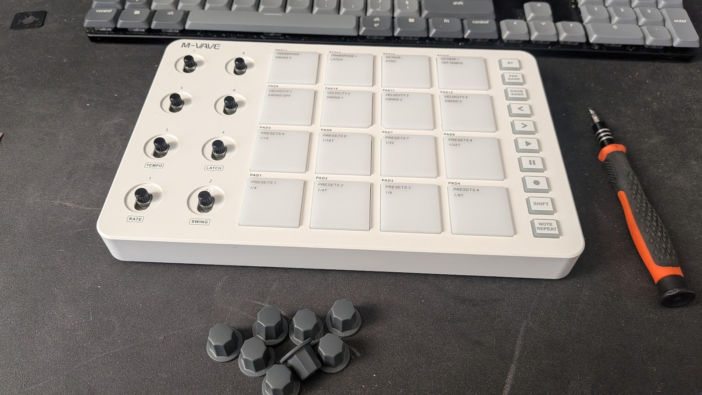
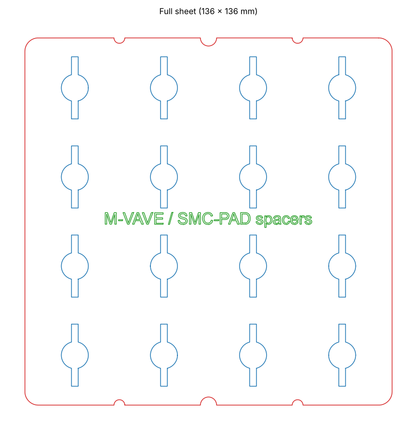
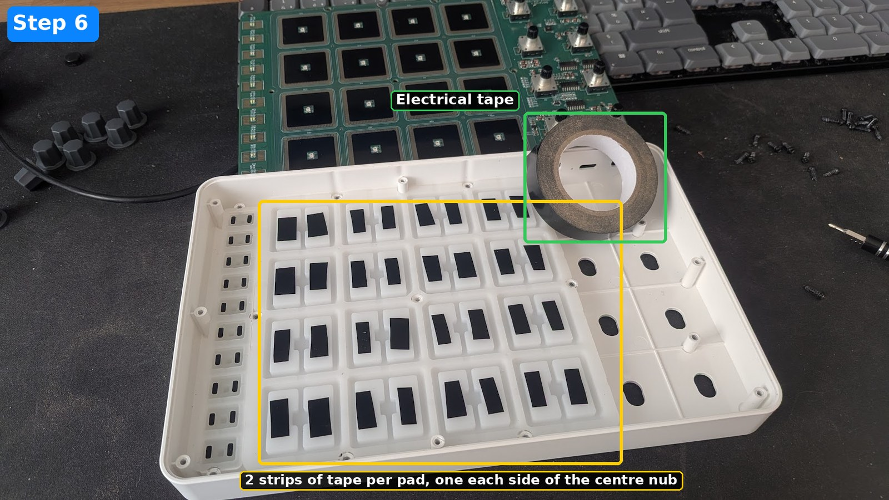
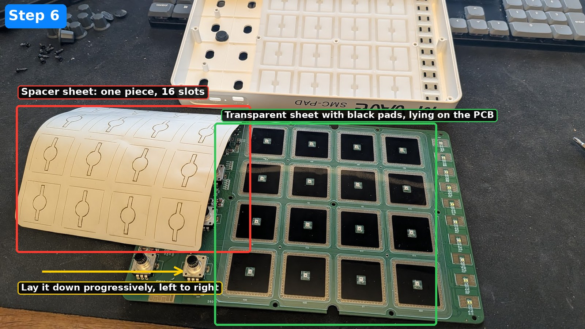
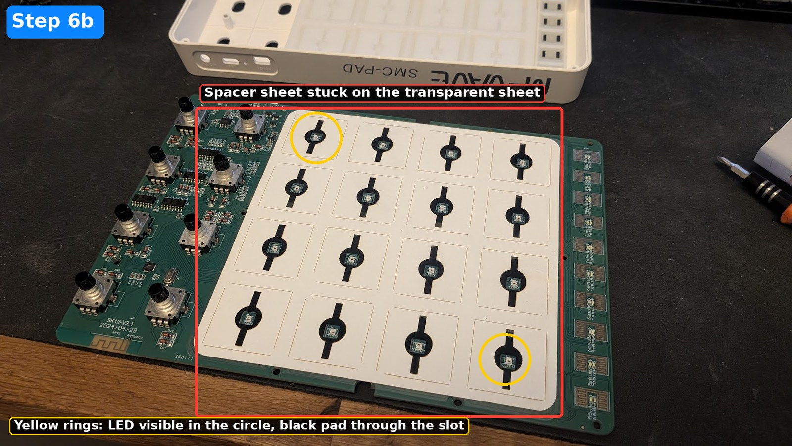
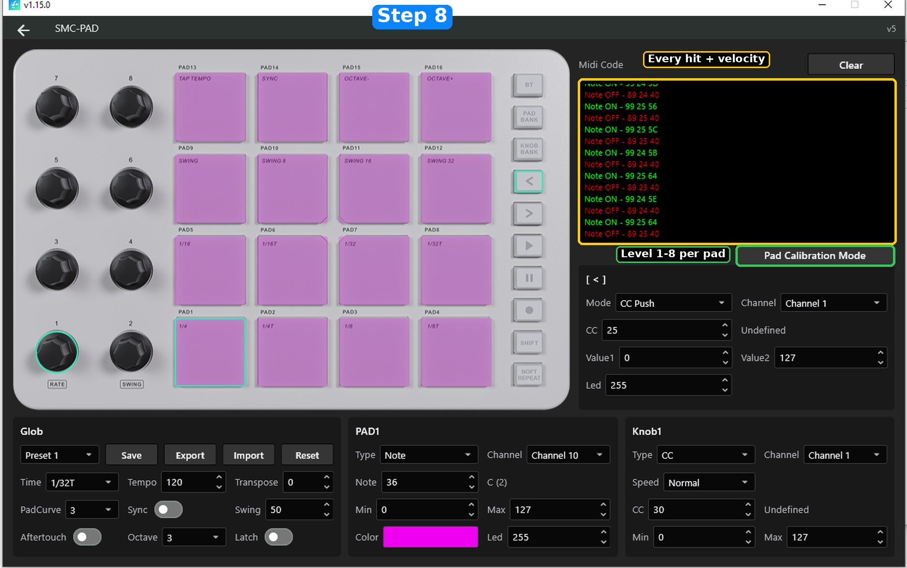
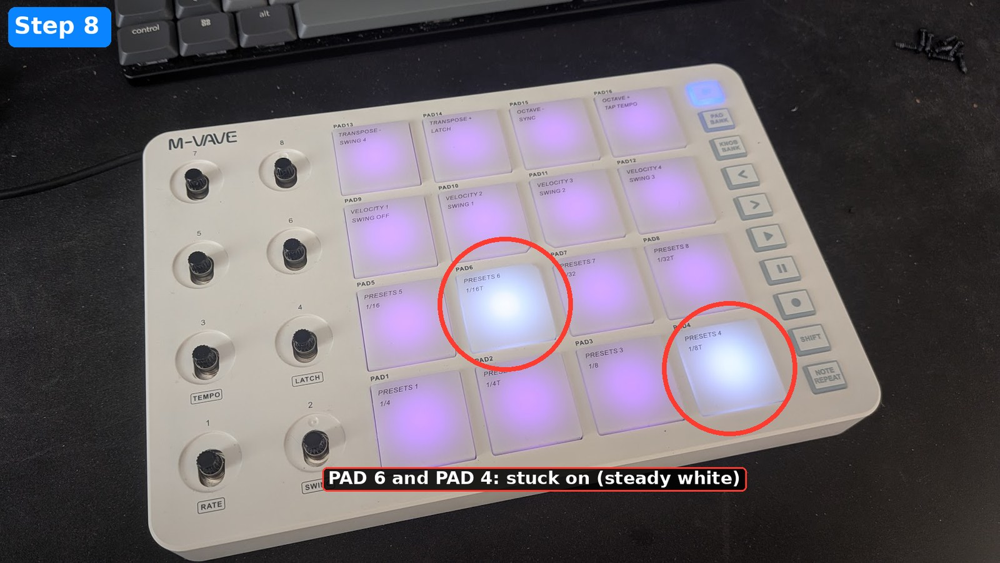

# M-Vave SMC-PAD: pad sensitivity mod

> **Warning: this mod voids your warranty. You do it entirely at your own risk and I am not responsible for any damage, see the [disclaimer](#disclaimer).**

Your SMC-PAD pads feel dead and you have to hammer them to get a decent velocity? This is a ~20 minute fix: open the unit, add a thin spacer on each pad, close it. No soldering, no glue gun, no 15-minute video. And the mod is **fully reversible**: nothing is cut or glued to the unit itself, peel the spacers off and it's back to stock.

I tried three kinds of spacers. **Strips of electrical tape are the clear winner** (and the cheapest), so that's what this guide recommends. The laser-cut and 3D-printed files are **experimental** and still need refining, see the comparison below.

> Inspired by Owl Muso's [M Vave SMC Pad Sensitivity Hack](https://www.youtube.com/watch?v=G5knDHVOgrA). Same idea, minus the video: ready-made spacer files and a step-by-step with annotated photos.

## Which spacers? What I tested

| Method | Result | Status |
|---|---|---|
| **Electrical tape** | **Best.** Surprisingly the most effective, the thickness is just right. Two pads ended up stuck on, easily fixed with the calibration and by loosening a screw a little (see step 8) | **Recommended**, tested |
| Laser-cut vinyl | Works, but doesn't add much sensitivity | Experimental, needs refining |
| 3D-printed | The worst: a lot of pads stuck on | Experimental, needs refining |

## What you need

- A **PH00** Phillips screwdriver
- A plastic pry tool, or a fingernail, to remove the rubber feet and the QR label
- **Electrical tape** (recommended): any common black PVC electrical tape, and scissors or a cutter
- or, experimental: laser-cut self-adhesive vinyl, or 3D-printed spacers (files below)
- Something to keep screws in, with two separate compartments: 9 case screws and 9 PCB screws (they're different)

## Files (experimental: laser-cut and 3D-printed spacers)

These files are **experimental** and need refining: the vinyl version works but adds little sensitivity, and the 3D-printed one leaves many pads stuck on. You don't need any of them for the recommended tape method. If you improve them, send a PR!

| File | What it is |
|---|---|
| [`files/SMC-Pad_spacers_full_sheet.dxf`](files/SMC-Pad_spacers_full_sheet.dxf) | **One full sheet (136 x 136 mm)** covering all 16 pads at once, with rounded corners and notches, directly at the right size |
| [`files/SMC-Pad_spacers_sheet_4x4.dxf`](files/SMC-Pad_spacers_sheet_4x4.dxf) | 16 individual spacers (27 x 27 mm each) on a 125 x 130 mm sheet |
| [`files/SMC-Pad_spacer_single.dxf`](files/SMC-Pad_spacer_single.dxf) | A single spacer (27 x 27 mm, with a round hole and a vertical slot) |
| [`files/SMC-Pad_spacers_LightBurn.lbrn2`](files/SMC-Pad_spacers_LightBurn.lbrn2) | Ready-to-run LightBurn project (sheets + title text + cut settings) |
| [`files/SMC-Pad_spacers_full_sheet.stl`](files/SMC-Pad_spacers_full_sheet.stl) | 3D-printable full sheet. Experimental: many pads stuck on |
| [`files/SMC-Pad_spacer_single.stl`](files/SMC-Pad_spacer_single.stl) | 3D-printable single spacer. Experimental: many pads stuck on |
| [`files/SMC-Pad_spacers_3Dprint.3mf`](files/SMC-Pad_spacers_3Dprint.3mf) | 3D-printing project (3MF), updated to the new design. Experimental: many pads stuck on |

All dimensions are in millimetres. In the previews below, blue is the spacer cut, green the title text and red the outline of the sheet.

### Making the spacers

**Electrical tape (recommended)**

No files needed. Cut **two small strips per pad** (32 in total), about the size of the ones in the photo of step 6, and stick them on each silicone pad, one on each side of the centre nub. One layer of tape is the right thickness.

**Laser-cut self-adhesive vinyl (experimental)**

Load `SMC-Pad_spacers_LightBurn.lbrn2`, or import one of the DXF files. The idea is to *kiss-cut*: cut through the vinyl but not through the backing.

The LightBurn project uses 3 layers, run in this order:

1. Title text, light engrave (1-5 % power, 25 mm/s)
2. Spacers (round holes, slots and outlines), kiss cut: 10-15 % power, 16.7 mm/s (1000 mm/min)
3. Sheet outline, full cut: 30 % power, 16.7 mm/s (1000 mm/min)

Those numbers come from my machine (LightBurn device profile `LR4`). Run a small test first and tune power on your own laser, then make sure the backing survives. In my test the vinyl worked but added little sensitivity.

**3D-printed (experimental)**

STL and 3MF files are provided for the same design. In my test it was the worst option: a lot of pads stayed stuck on. Treat the files as a starting point and let me know how it goes.

## Step by step

> Work on a mat, keep the screws sorted per step, and don't force anything. Before you start, switch the pad off and unplug the USB cable.

### 1. Pull the knobs

Use a flat screwdriver and go **very slowly**. Slide it under the edge of a knob and lift a little, then move around the knob and lift from different angles. Never pull on one side only, or you'll bend the potentiometer. Repeat for all 8 knobs.

### 2. Undo the back screws

Flip the unit over.

- **1 to 4**: the four corner screws are hidden under the round rubber feet. Pry the feet off, then undo the screws.
- **5 to 8**: four uncovered screws, in the middle of each side.
- **9**: peel the QR label back to find the centre screw, and undo it.

That's 9 case screws in total.

Lift the bottom plate off. You now see the PCB (with the battery) sitting in the top shell.

### 3. Unplug the battery first

**Before you undo anything on the PCB, disconnect the battery.** Unplug the small white JST connector of the 3.7 V / 2000 mAh LiPo. Pull on the connector, not on the wires.

### 4. Remove the 9 PCB screws

Undo the 9 black screws that hold the PCB. The photo shows the 9 screw holes, with the screws already out.

> **Careful: the case screws and the PCB screws are not the same.** Keep them in two separate piles. The hole in the middle of the PCB is not for a PCB screw: it lets the **case screw** (step 2, screw 9) go through the PCB. When you put the PCB back, don't screw anything into that hole.

### 5. Lift out the PCB

Take the PCB out gently. The sheet with the black squares is a **separate, loose sheet**, not attached to the PCB or to the case. **Pay attention to its orientation**: it must go back the same way up and the same way round. The easy way: lay it down on the PCB, so it keeps its orientation. The pad cavities in the top shell are now empty. Leave the sheet lying on the PCB for the next step.

### 6. Add the spacers

**Electrical tape (recommended)**

Stick **two strips of electrical tape on each silicone pad** in the top shell, one on each side of the centre nub, as in the photo. Do all 16 pads and keep them as even as possible (same strips, same position).

> **Want more sensitivity?** Add a second layer of tape. **Pads stay lit?** Too thick, see step 8.

**Laser-cut vinyl (experimental)**

The transparent sheet with the black pads is lying on the PCB (step 5). Stick the vinyl **directly on it**.

> **Careful with the side:** stick the spacers on the **silicone-pad side** of the sheet (the side that faces the case), **not on the PCB side**. Once the sheet is lying on the PCB, that's the side facing up.

1. Remove the round holes and the slots from the vinyl so they're open, then peel the full sheet off its backing.
2. Lay it over the 16 pads in one go, starting from one edge and going progressively to avoid bubbles. Each round hole goes over a LED, with the slot vertical, as in the photos.
3. Check that you can see the LED through each round hole and the black pad through each slot.

### 7. Close it up

Reverse the steps:

1. Swing the PCB back over the case, the reverse of how you took it out, with the transparent sheet lying on it (and the vinyl spacers, if you used them). The sheet ends up against the silicone pads, the same way up as it came out, and the spacers sit between them. Take your time, this is where it's easy to flip it.
2. Check that the PCB is lined up on its posts.
3. Refit the 9 black PCB screws, and only those. Leave the centre hole empty (it's for the case screw, see step 4).
4. Plug the battery back in (last, once the PCB is screwed down).
5. Fit the bottom plate and refit the 9 case screws (4 corners, 4 mid-side, and the centre one, which goes through the PCB hole).
6. Put the rubber feet back, stick the QR label back, push the 8 knobs on.

Plug it in and power it on. Last step: test and calibrate the pads in software.

### 8. Test and calibrate in MidiSuite

MidiSuite, M-Vave's editor, is the tool to check that your hits are properly registered and to adjust the sensitivity of each pad.

1. Install **MidiSuite** (v1.15.0 in the screenshots). All downloads are on the official page: [m-vave.com/download](https://www.m-vave.com/download). Direct links to the current version:
   - Windows: [MidiSuite_new.zip](https://yms-file-store.oss-cn-hongkong.aliyuncs.com/software/pc/MidiSuite_new.zip)
   - macOS: [MidiSuite_new.dmg](https://yms-file-store.oss-cn-hongkong.aliyuncs.com/software/pc/MidiSuite_new.dmg)
   - Mobile apps: [iOS](https://apps.apple.com/us/app/midi-suite/id6737530581) and [Android (APK)](https://resource.m-vave.com/software/app/MidiSuite.apk) (the mobile app lists the SMC-PAD Pocket, not the SMC-PAD, so use the desktop version)
2. Connect the SMC-PAD and open MidiSuite.
3. **Test your hits.** Play the pads, soft and hard, slow and fast. The **Midi Code** frame at the top right shows every hit that is registered: a green `Note ON` with the note and the velocity (the last value, in hexadecimal), then a red `Note OFF`. Check that all your hits show up, that the velocity follows how hard you hit, and that quick repeated hits are all registered. Use **Clear** to empty the frame.

4. **Adjust the sensitivity.** Click **Pad Calibration Mode**. Every pad has its own level, from **Level 1 to Level 8** (factory setting: **Level 4**). Changes are saved to the device immediately. Hit a pad, adjust its level, check the Midi Code frame again, and repeat for each of the 16 pads until they all feel even.

5. **Still not sensitive enough** after raising the level? Add a **second layer** of tape, or use a **slightly thicker** spacer.
6. **Some pads are stuck on (steady white)?** The spacer is a bit too thick for that pad. In my tape test two pads did that (the photo shows PAD 6 and PAD 4). Two easy fixes: lower that pad's level in the calibration, and/or **loosen a PCB screw a little** near that pad to relieve the pressure. If it persists, use thinner tape on that pad.

Since the mod is fully reversible, you can open the unit again (steps 1 to 7) and redo the spacers as many times as needed.

## Disclaimer

**This mod voids your warranty.** You open the unit and modify it at your own risk.

This guide and these files are provided "as is", without warranty of any kind. I am not responsible for any damage to your device, battery or anything else, nor for any injury or loss resulting from following this guide or using these files. You do this entirely at your own risk.

The unit contains a lithium battery: don't puncture or bend it, don't short anything, and unplug it before touching the PCB (step 3). This project is not affiliated with, endorsed by or supported by M-Vave.

## License

Files and text: [CC BY-SA 4.0](LICENSE). Share your results and improvements, PRs welcome.
