# M-Vave SMC-PAD: pad sensitivity mod

Your SMC-PAD pads feel dead and you have to hammer them to get a decent velocity? This is a ~20 minute fix: open the unit, stick 16 small spacers in the pad cavities, close it. No soldering, no glue gun, no 15-minute video.

Spacers are **laser-cut** (self-adhesive paper), **3D-printed**, or just **strips of electrical tape**. Pick whichever you have.

> Inspired by Owl Muso's [M Vave SMC Pad Sensitivity Hack](https://www.youtube.com/watch?v=G5knDHVOgrA). Same idea, minus the video: ready-made spacer files and a step-by-step with annotated photos.

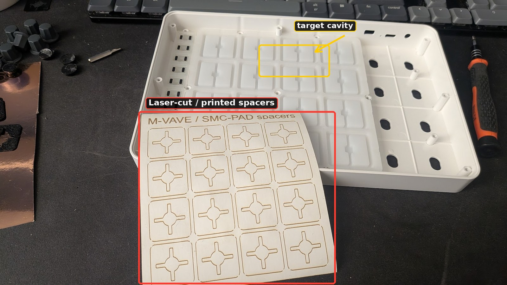

## What you need

- A **PH0** Phillips screwdriver
- A plastic pry tool, or a fingernail, to remove the rubber feet and the QR label
- **16 spacers**, one of:
  - laser-cut self-adhesive (sticker) paper, files below
  - 3D-printed spacers (0.3 mm thick), file below
  - no laser, no printer? Strips of electrical tape (see below)
- Something to keep screws in, with two separate compartments: 9 case screws and 9 PCB screws (they're different)

## Files

| File | What it is |
|---|---|
| [`files/SMC-Pad_spacer_single.dxf`](files/SMC-Pad_spacer_single.dxf) | One spacer: 24 x 24 mm, 3 mm corner radius, cross cut-out |
| [`files/SMC-Pad_spacers_sheet_4x4.dxf`](files/SMC-Pad_spacers_sheet_4x4.dxf) | 16 spacers on a 112 x 122 mm sheet (26 mm pitch). Layer `CUT_KISS` = spacers, layer `CUT_OUTER` = sheet outline |
| [`files/SMC-Pad_spacers_LightBurn.lbrn2`](files/SMC-Pad_spacers_LightBurn.lbrn2) | Ready-to-run LightBurn project (sheet + title text + cut settings) |
| [`files/SMC-Pad_spacers_3Dprint.3mf`](files/SMC-Pad_spacers_3Dprint.3mf) | 16 printed spacers, 23 x 23 x 0.3 mm. Sliced in Bambu Studio |

All dimensions are in millimetres.

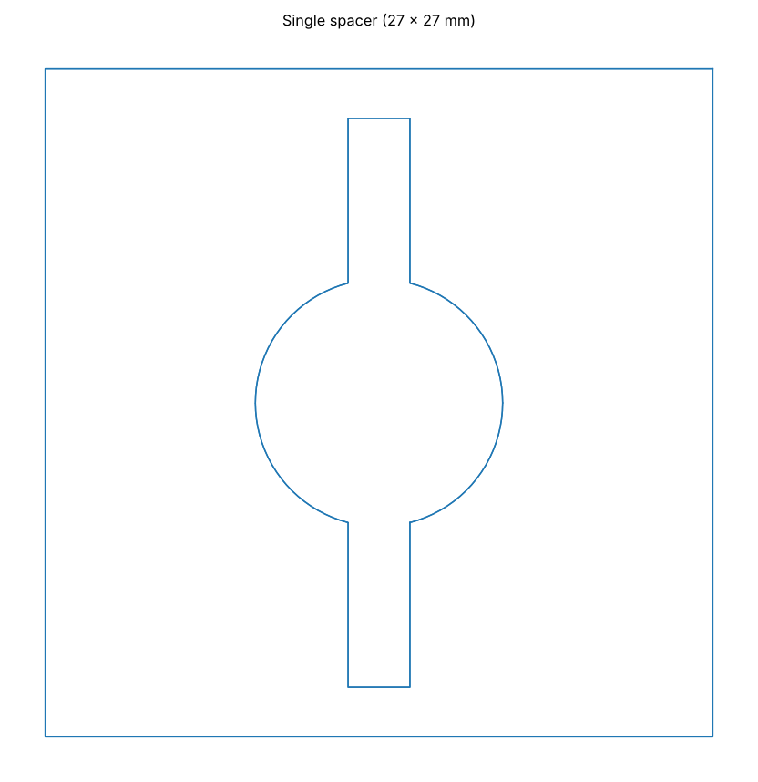
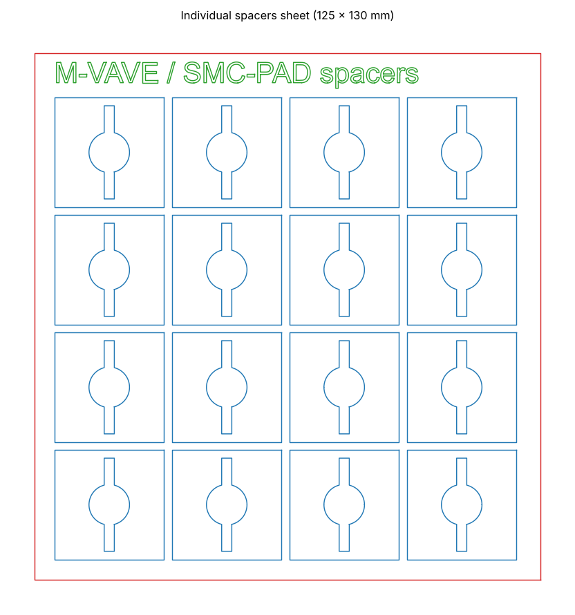

### Making the spacers

**Laser-cut (sticker paper)**

Load `SMC-Pad_spacers_LightBurn.lbrn2`, or import the sheet DXF. The idea is to *kiss-cut*: cut through the paper but not through the backing, so every spacer stays on its liner until you peel it.

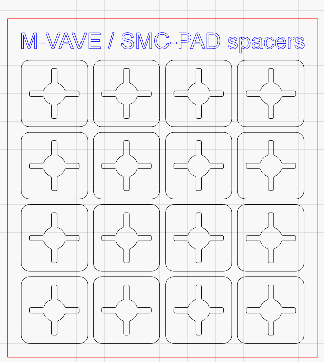

The LightBurn project uses 3 layers, run in this order:

1. Title text, light engrave (1-5 % power, 25 mm/s)
2. Spacers (outline and cross), kiss cut: 10 % power, 16.7 mm/s (1000 mm/min)
3. Sheet outline, full cut: 30 % power, 16.7 mm/s (1000 mm/min)

Those numbers come from my machine (LightBurn device profile `LR4`). Run a small test first and tune power on your own laser, then make sure the backing survives.

**3D-printed**

Open the 3MF in Bambu Studio / Orca / PrusaSlicer. The project is set up for a Bambu Lab P1S, 0.6 mm nozzle, 0.12 mm layers, 2 walls, no supports. At 0.3 mm thick, the spacers are only a few layers. Print one first to check the fit, then print the rest.

**Electrical tape (no tools needed)**

Cut strips of electrical tape and stick them in the cavities instead of the spacers, in step 6. Cheapest and quickest option.

## Step by step

> Work on a mat, keep the screws sorted per step, and don't force anything. Before you start, switch the pad off and unplug the USB cable.

### 1. Pull the knobs

Use a flat screwdriver and go **very slowly**. Slide it under the edge of a knob and lift a little, then move around the knob and lift from different angles. Never pull on one side only, or you'll bend the potentiometer. Repeat for all 8 knobs.

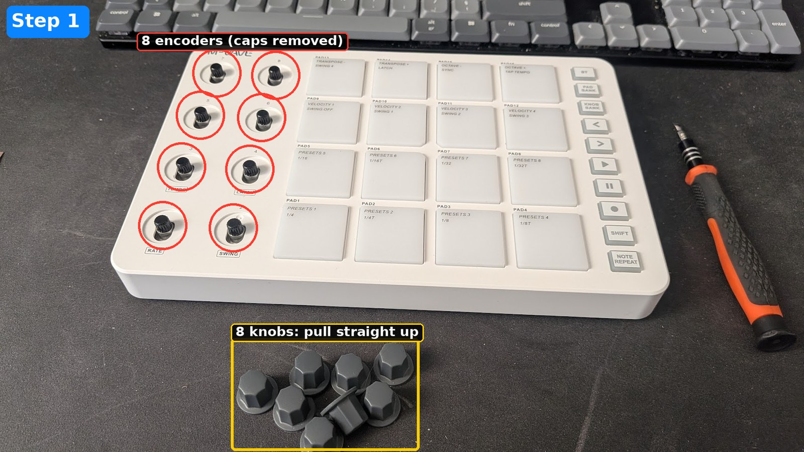

### 2. Undo the back screws

Flip the unit over.

- **1 to 4**: the four corner screws are hidden under the round rubber feet. Pry the feet off, then undo the screws.
- **5 to 8**: four uncovered screws, in the middle of each side.
- **9**: peel the QR label back to find the centre screw, and undo it.

That's 9 case screws in total.

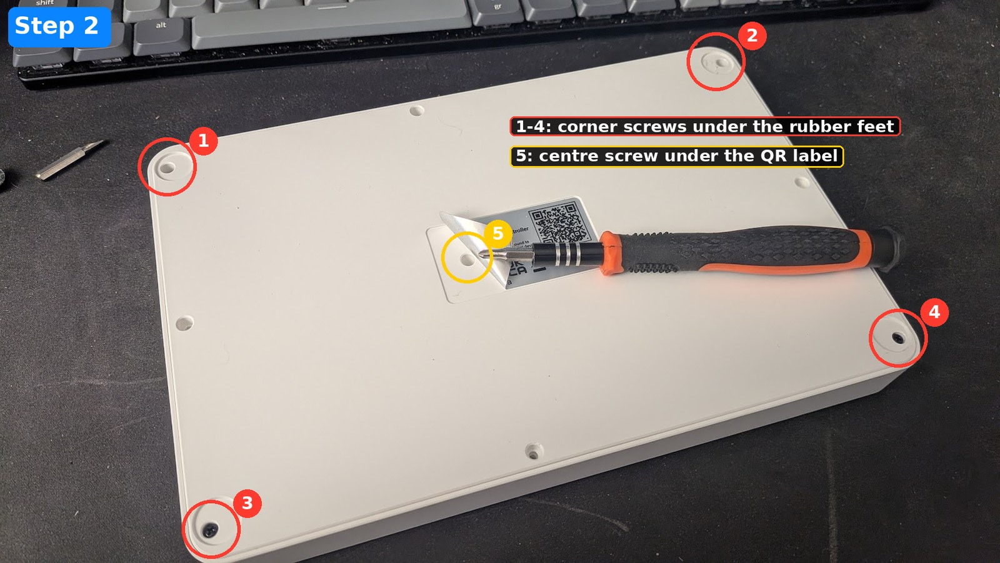

Lift the bottom plate off. You now see the PCB (with the battery) sitting in the top shell.

### 3. Unplug the battery first

**Before you undo anything on the PCB, disconnect the battery.** Unplug the small white JST connector of the 3.7 V / 2000 mAh LiPo. Pull on the connector, not on the wires.

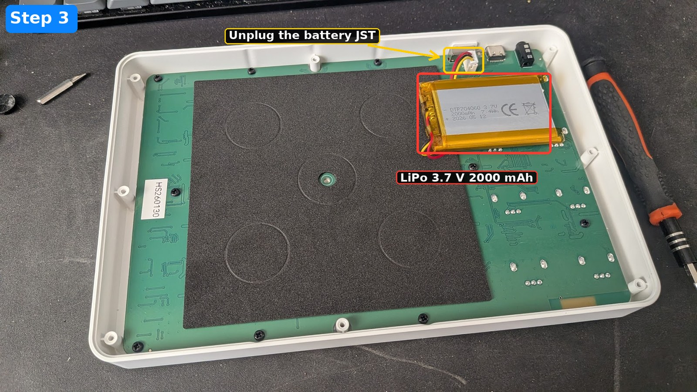

### 4. Remove the 9 PCB screws

Undo the 9 black screws that hold the PCB. The photo shows the 9 screw holes, with the screws already out.

> **Careful: the case screws and the PCB screws are not the same.** Keep them in two separate piles. The hole in the middle of the PCB is not for a PCB screw: it lets the **case screw** (step 2, screw 9) go through the PCB. When you put the PCB back, don't screw anything into that hole.

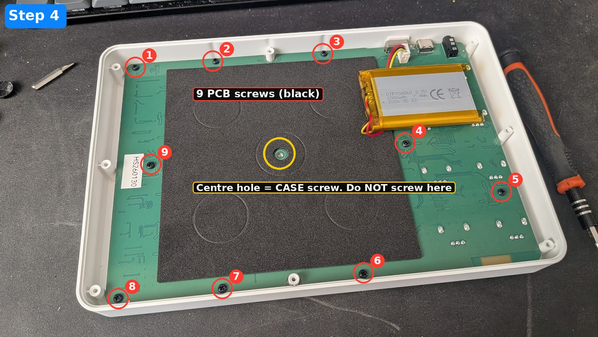

### 5. Lift out the PCB

Take the PCB out gently. The sheet with the black squares is a **separate, loose sheet**, not attached to the PCB or to the case. **Pay attention to its orientation**: it must go back the same way up and the same way round. The easy way: lay it down on the PCB as if you were opening the page of a book, so it keeps its orientation. The pad cavities in the top shell are now empty.

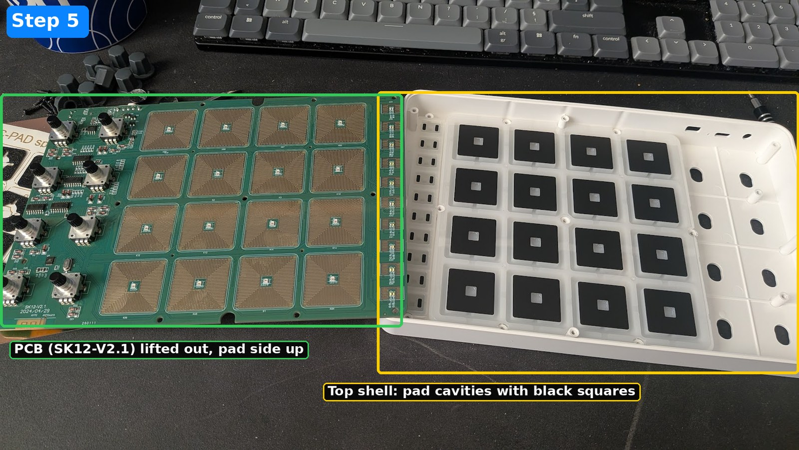

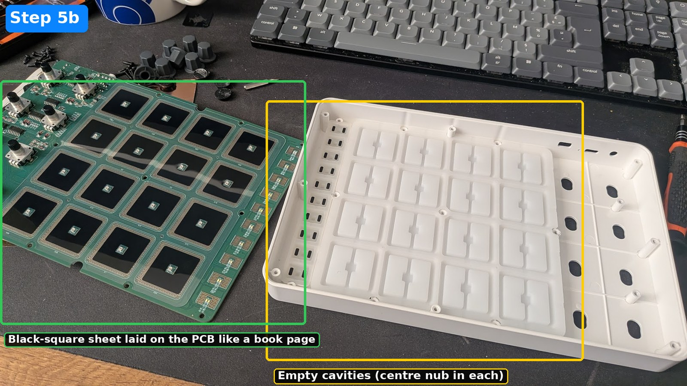

### 6. Stick the spacers

Each pad cavity has a small nub in the middle. For each of the 16 cavities:

1. Peel one spacer off its backing (laser-cut version), place a printed one, or stick your tape strips.
2. For cut or printed spacers, centre the **cross cut-out on the nub**, and press it flat into the cavity.

Do all 16. Don't leave any out, or that pad will stay dull.

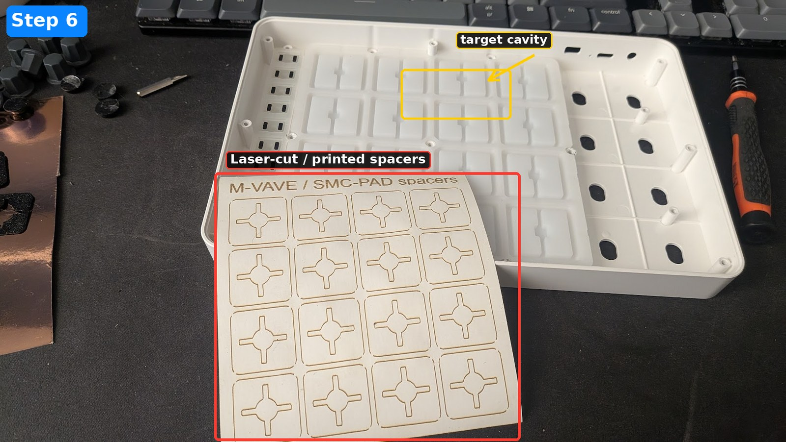

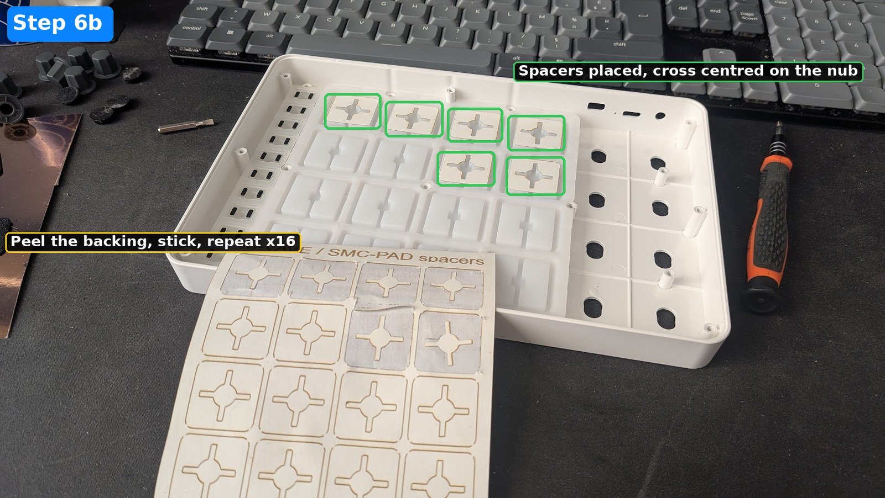

### 7. Close it up

Reverse the steps:

1. Put the black-square sheet back in the cavities, over the spacers, in the same orientation as it came out. Take your time: this is where it's easy to get it flipped.
2. Put the PCB back, pad side down, lined up on its posts.
3. Refit the 9 black PCB screws, and only those. Leave the centre hole empty (it's for the case screw, see step 4).
4. Plug the battery back in (last, once the PCB is screwed down).
5. Fit the bottom plate and refit the 9 case screws (4 corners, 4 mid-side, and the centre one, which goes through the PCB hole).
6. Put the rubber feet back, stick the QR label back, push the 8 knobs on.

Plug it in and power it on. Last step: calibrate the pads in software.

### 8. Calibrate the pads in MidiSuite

The mod fixes the hardware, but the pads still need to be calibrated in software, otherwise you won't get the full benefit.

1. Install **MidiSuite**, M-Vave's editor (v1.15.0 in the screenshot). All downloads are on the official page: [m-vave.com/download](https://www.m-vave.com/download). Direct links to the current version:
   - Windows: [MidiSuite_new.zip](https://yms-file-store.oss-cn-hongkong.aliyuncs.com/software/pc/MidiSuite_new.zip)
   - macOS: [MidiSuite_new.dmg](https://yms-file-store.oss-cn-hongkong.aliyuncs.com/software/pc/MidiSuite_new.dmg)
   - Mobile apps: [iOS](https://apps.apple.com/us/app/midi-suite/id6737530581) and [Android (APK)](https://resource.m-vave.com/software/app/MidiSuite.apk) (the mobile app lists the SMC-PAD Pocket, not the SMC-PAD, so use the desktop version)
2. Connect the SMC-PAD and open MidiSuite.
3. Click **Pad Calibration Mode**.
4. Every pad has its own sensitivity level, from **Level 1 to Level 8** (factory setting: **Level 4**). Changes are saved to the device immediately.
5. Hit a pad, adjust its level, hit it again. Repeat for each of the 16 pads until they all feel even.

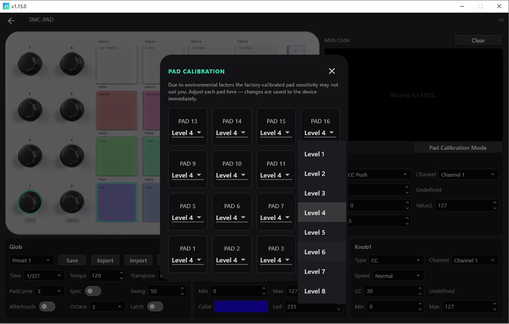

## Disclaimer

You're opening a device with a lithium battery inside. Do this at your own risk, don't puncture or bend the battery, and don't short anything. This will probably void your warranty. This project is not affiliated with M-Vave.

## License

Files and text: [CC BY-SA 4.0](LICENSE). Share your results and improvements, PRs welcome.
